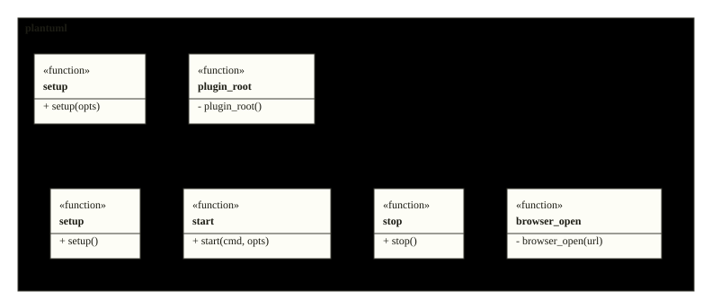
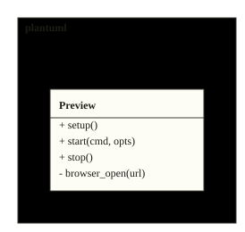

# Architecture

Two Lua modules carry the plugin: init wires filetype, treesitter,
folds and the language server; preview owns the served interactive
preview. The figures below are the repository's actual design, rendered
from its sources on every inject.

<!-- folio: design --assets assets -->
### System view

#### HLD_PlantumlNvim

_hld · `design/hld/HLD_PlantumlNvim.puml`_

- traces to: `SREQ-00001-1` `SREQ-00002-1`

### Module overview

#### CL_PlantumlNvim

_cl · `design/lld/plantuml/CL_PlantumlNvim.puml`_

- traces to: `REQ-00001-1` `REQ-00002-1` `REQ-00003-1`
- implemented in: `lua/plantuml/init.lua` · `lua/plantuml/preview.lua`
- verified by: `tests/editor.lua` (44) · `tests/wiring.lua` (9)

### Class detail

<code>CL_Init</code> · traces to <code>REQ-00001-1</code> <code>REQ-00002-1</code>

<ul>
<li>source: <code>design/lld/plantuml/CL_Init.puml</code></li>
<li>implemented in: <code>lua/plantuml/init.lua</code></li>
<li>verified by: <code>tests/editor.lua</code> (42), <code>tests/wiring.lua</code> (8)</li>
</ul>

<code>CL_Preview</code> · traces to <code>REQ-00003-1</code>

<ul>
<li>source: <code>design/lld/plantuml/preview/CL_Preview.puml</code></li>
<li>implemented in: <code>lua/plantuml/preview.lua</code></li>
<li>verified by: <code>tests/editor.lua</code> (2), <code>tests/wiring.lua</code> (1)</li>
</ul>

<!-- /folio -->
